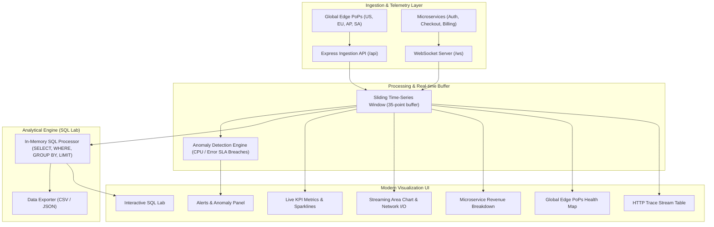

# Real-time Analytics Dashboard

A modern, high-performance, turnkey **Real-time Analytics Dashboard** engineered as an enterprise-grade reference and modernized alternative to **Apache Superset**. Built with **React 18, TypeScript, Tailwind CSS, WebSockets, and Express**, it provides real-time streaming telemetry, an interactive SQL Lab, a visual Chart Studio, automated anomaly detection, and sub-second SLA monitoring.

---

## 🚀 Key Highlights & Comparison with Apache Superset

| Feature | Apache Superset | Real-time Analytics Dashboard |
| :--- | :--- | :--- |
| **Telemetry & Updates** | Polling / Celery / WebSockets | Native sub-second bidirectional WebSockets & 60fps streaming canvas |
| **SQL Query Lab** | Rich SQL Lab with Trino/Presto | Interactive SQL Lab with instant in-memory evaluation, schemas, & CSV/JSON export |
| **Explore / Chart Studio** | Heavy multi-step chart builder | Instant visual slice builder with live canvas preview & color themes |
| **Anomaly Detection** | Static alerts via Celery beat | Live rule threshold tuner with instant burst simulation & SLA breach detection |
| **Web Design & UX** | Legacy Ant Design & Webpack | Modern glassmorphism, Dark/Light modes, NOC kiosk mode, Tailwind CSS |
| **Deployment Footprint** | Gigabytes (Postgres, Redis, Python, Celery) | Ultra-lightweight (~264 kB bundle, Docker single container, Vercel ready) |

---

## 🛠️ Architecture Overview



---

## 📦 Project Structure

```
real-time-analytics-dashboard/
├── Dockerfile                  # Multi-stage production container build
├── docker-compose.yml          # Docker Compose configuration with healthchecks
├── index.html                  # HTML5 entrypoint with Google Fonts & dark theme default
├── package.json                # Project dependencies and deployment scripts
├── postcss.config.js           # PostCSS configuration
├── render.yaml                 # 1-click Render blueprint
├── tailwind.config.js          # Tailwind CSS design system with custom palettes
├── tsconfig.json               # TypeScript compiler configuration
├── vercel.json                 # Vercel Edge configuration
├── server/
│   └── index.js                # Express REST API & WebSocket streaming server
└── src/
    ├── App.tsx                 # Main application layout and tab router
    ├── index.css               # Tailwind directives and glassmorphic styling
    ├── main.tsx                # React DOM root initialization
    ├── types/
    │   └── index.ts            # TypeScript interfaces for telemetry, alerts, and schemas
    ├── utils/
    │   └── mockEngine.ts       # SQL parser, simulation generator, and CSV/JSON exporter
    ├── context/
    │   └── DashboardContext.tsx # Centralized WebSocket/stream state & alert manager
    └── components/
        ├── layout/
        │   ├── Header.tsx      # Top bar with status pill, burst simulator, and NOC mode
        │   └── Sidebar.tsx     # Navigation, cluster telemetry, and SLA health
        ├── dashboard/
        │   ├── FilterBar.tsx   # Native time-range, region, and service filter bar
        │   └── KPISection.tsx  # KPI cards with live animated sparklines and SLA badges
        ├── charts/
        │   ├── RealtimeAreaChart.tsx    # High-frequency streaming throughput chart
        │   ├── RevenueBarChart.tsx      # Categorical revenue by microservice
        │   ├── GeoDistributionMap.tsx   # Interactive Global Edge PoP health
        │   ├── DonutChart.tsx           # HTTP status code response distribution
        │   └── LiveEventStreamTable.tsx # Live HTTP trace feed with payload inspector
        ├── sqllab/
        │   └── SqlLab.tsx      # Interactive SQL query workspace and result tables
        ├── explore/
        │   └── ChartStudio.tsx # Drag-and-drop style chart studio slice builder
        ├── alerts/
        │   └── AlertsPanel.tsx # SLA threshold sliders and anomaly incident feed
        ├── datasets/
        │   └── DatasetsView.tsx# Metadata registry and column definitions
        └── deployment/
            └── DeploymentGuide.tsx # In-app copyable cloud deployment instructions
```

---

## 🚀 Quick Start Guide

### Prerequisites
- **Node.js**: v18.0.0 or higher (compatible up to Node.js v26+)
- **npm** or **yarn** / **pnpm**

### 1. Install Dependencies
```bash
npm install
```

### 2. Development Mode
Run the Vite development server with hot module reloading:
```bash
npm run dev
```
Open [http://localhost:3000](http://localhost:3000) in your browser.

### 3. Production Build & Execution
Build the optimized static assets and launch the production server with integrated WebSockets:
```bash
npm run build
npm run start
```
The application will be live at [http://localhost:5000](http://localhost:5000).

---

## 🐳 Docker Deployment

Deploy in an isolated container using Docker and Docker Compose:

```bash
docker-compose up -d --build
```

To stop the container:
```bash
docker-compose down
```

Check health status:
```bash
curl http://localhost:5000/api/health
```

---

## ☁️ Cloud 1-Click Deployment

### Vercel
Deploy the frontend directly to Vercel:
```bash
npm i -g vercel
vercel --prod
```
The included `vercel.json` automatically configures routes and headers.

### Render / Railway / Fly.io
The repository includes a ready `render.yaml` blueprint. Simply push the repository to GitHub and connect it to your Render or Railway dashboard.

---

## 🔌 API & WebSocket Reference

### HTTP Endpoints
- `GET /api/health` - Cluster healthcheck, uptime, active WebSocket connections, and RAM usage.
- `GET /api/metrics/summary` - Latest system metrics (TPS, revenue, latency, CPU, error rate).
- `GET /api/events` - Recent live HTTP traces and microservice events.
- `POST /api/query` - Executes SQL statements against dataset tables.
  ```json
  {
    "sql": "SELECT region, COUNT(*) as count FROM events GROUP BY region;"
  }
  ```

### WebSocket Streaming (`ws://localhost:5000/ws`)
Broadcasts telemetry packets on every tick:
```json
{
  "type": "telemetry",
  "payload": {
    "metric": {
      "timestamp": "2026-11-13T21:40:00.000Z",
      "requestsPerSec": 2420,
      "revenue": 195,
      "latencyMs": 48,
      "cpuUsage": 44,
      "errorRate": 0.65
    },
    "event": {
      "id": "evt_9a41b2",
      "service": "checkout-api",
      "method": "POST",
      "statusCode": 200,
      "latencyMs": 45
    }
  }
}
```

---

## 📄 License
MIT License. Crafted for enterprise real-time streaming business intelligence.

